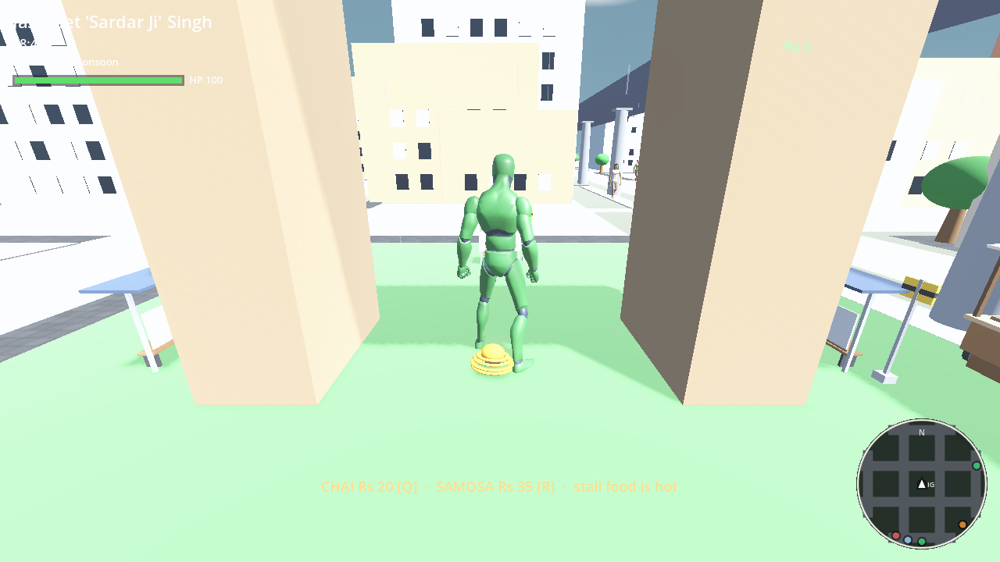
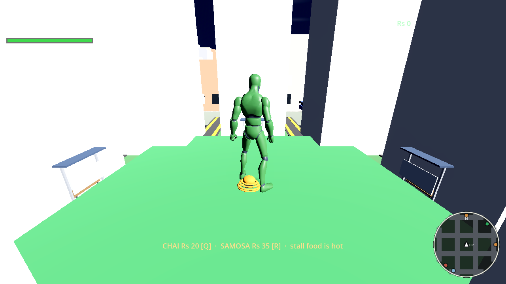
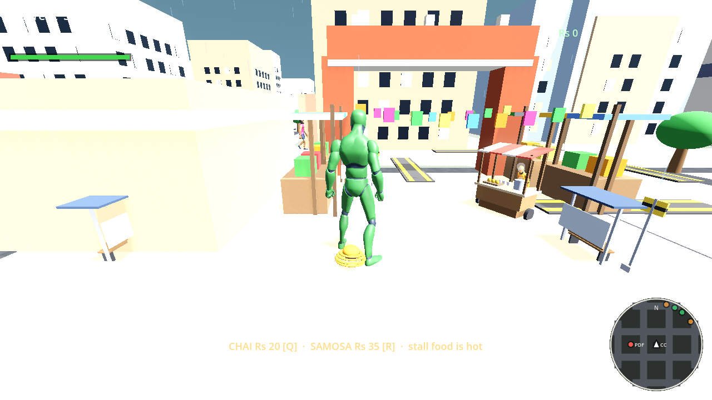
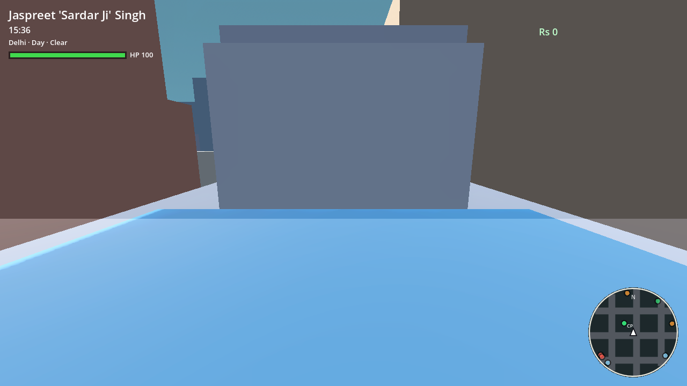
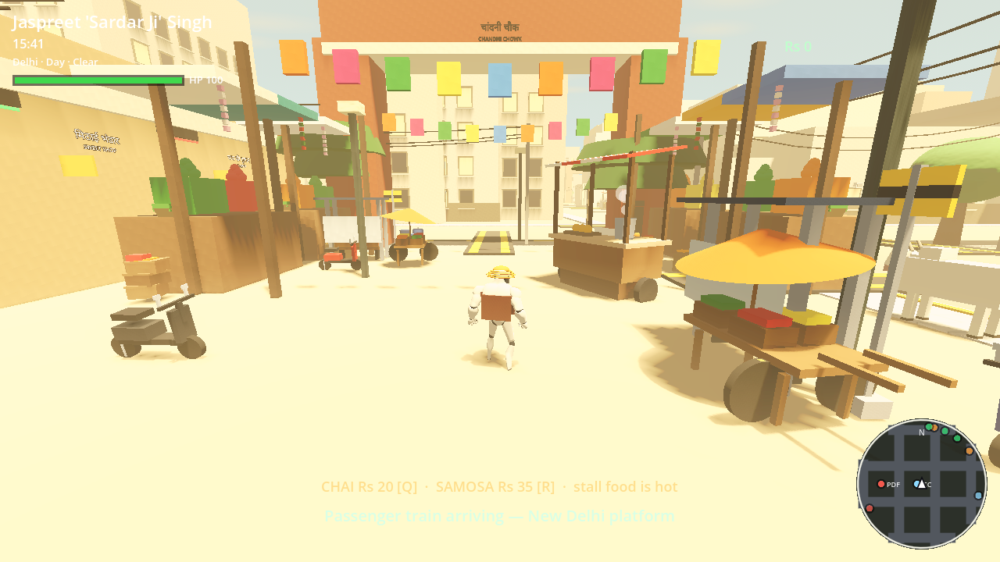
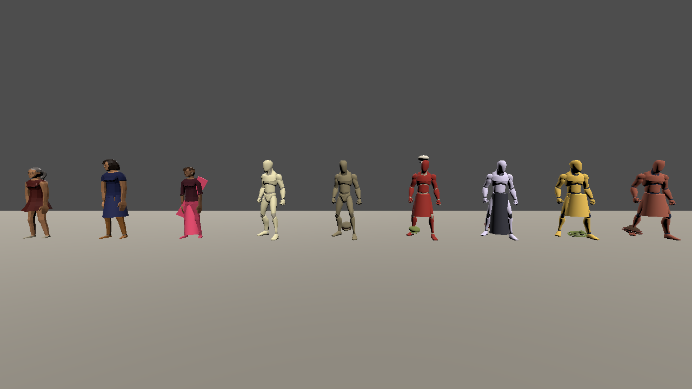

# Delhi Freetown Loot 🪯🛺

**An indie free-roam loot game set in Delhi** — an original
open-world homage to the PS2-era classics, built 100% from scratch on
[Godot 4](https://godotengine.org) (MIT-licensed engine). No third-party
assets: every building, character, vehicle, sound and song is generated
procedurally in code.

**v1.0 is live** — free roam from minute one. Read the
[release notes](PLAN.md#8--changelog).

| | |
|---|---|
|  |  |
|  |  |
|  |  |

## The city

Free-roam a stylized low-poly Delhi — India Gate, the Connaught Place
roundabout, Purani Dilli's red fort and dome, Chandni Chowk's bazaar
lanes, Hauz Khas, neighbourhood parks, river ghats and an elevated metro
line you can actually ride: board at a street gate and watch the city go
by from the interior cam. A full day/night cycle, monsoon squalls with
slick streets, and a living soundtrack — morning temple bells, the
evening call from the masjid, three procedural radio stations in every
auto.

The streets are populated: pedestrians of all ages — kids, elders,
street characters — chatting pairs, bench idlers, paan-eaters at the
counter, stray dogs dozing in the sun and station monkeys causing
trouble. Walk-in interiors open off the pavement: a kirana store, a
paan shop, a pavement bookstore.

## The life of a puller

- **Wanted system** — cause chaos and police jeeps hunt you through the
  grid; lose them and the heat cools. Get cornered while wanted and it's
  **BUSTED** — fined, respawned outside the thana, heat wiped. Or slip
  an officer Rs cash with **B** and walk away early.
- **Missions for cash** — glowing street markers hand out jobs with
  typewriter dialogue: the Gate run (Rs 250), the timed CP crate run
  (Rs 450), the three-stop chai run against a cooling timer (Rs 600),
  and the checkpoint ring race against two rival autos (Rs 650).
- **Kahani story arcs** — each legend opens with a one-shot intro
  chapter and closes with a proper outro: Sardar Ji's pawned auto-stand
  battery, Riya's three-parcel instalment run, Monty's ninety-second
  pass hustle (Rs 700–900, one-shot).
- **Street economy** — thela carts at every landmark sell chai and
  samosas (mission cash in, health back out). Outfit sellers offer
  threads; your wardrobe carries your prints.
- **Photo mode** — freeze the city, frame it, cycle filters, and keep a
  gallery.

## The legends

- **Jaspreet "Sardar Ji" Singh** — auto-rickshaw legend of Connaught Place
- **Riya Sharma** — delivery rider, fastest lanes in the city
- **Monty "Dilli ka Don" Malhotra** — Connaught Place hustler

Switch between them any time with **Tab**.

## Controls

| Action | Keyboard | Gamepad |
|---|---|---|
| Move | WASD / arrows | left stick |
| Sprint | Shift | RB |
| Interact · enter/exit vehicle | E | A |
| Horn | H | B |
| Cycle radio station | N | X |
| Switch legend | Tab | Y |
| Chai / samosa from stalls | Q / R | D-pad up / down |
| Buy / cycle outfit | T / Y | D-pad right / left |
| Bribe the police | B | LB |
| Map | M | LB |
| Photo mode / filter / shutter / gallery | P / F / Enter / G | — |
| Save | F9 | Start |
| Pause / settings | Esc | Back |
| Advance dialogue (W/S picks choices) | Space | A |
| Debug hurt / drop | X / C | — |

**Touch** — an on-screen joystick + buttons appears automatically on
touchscreen devices, including a photo button (also in the browser
build on phones).

## ▶ Play in browser

**https://ayushsahnios.github.io/delhi-freetown-loot/** — deployed
automatically from master (single-threaded web export, works on plain
static hosting).

## Run it

Open this folder in **Godot 4.7+** and press F5, or headless:

```bash
godot --headless --import
godot --path .
```

Web export (any static host):

```bash
godot --headless --export-release "Web" build/index.html
```

## QA screenshots

The game renders server-side so every PR can be reviewed visually:

```bash
godot --headless --import .
xvfb-run -a -s "-screen 0 1280x720x24" godot --path . \
  --rendering-driver opengl3 res://scenes/screenshot.tscn \
  -- --out shot.png --frames 120 [--tp X,Z]
```

CI renders `spawn.png` and `center.png` on every PR and uploads them as
a `gameplay-screenshots` artifact — check it before merging visual
changes. Full-city capture index: [docs/screenshots.md](docs/screenshots.md).

## Attribution

Everything in this repository is original work. City geometry,
characters, vehicles, props, audio and music are generated
procedurally by our own code; the only external dependency is the
[Godot Engine](https://godotengine.org) (MIT license). Should any CC0
asset pack ever be adopted, it will be credited here by name. Game
*mechanics* take inspiration from the open-world genre; no code,
assets, audio, names, or trademarks from any commercial game are used
anywhere in this project.

## Roadmap

v0.2 Streets Alive (traffic AI, pedestrians, minimap, audio) →
v0.3 Wanted (police, heat) → v0.4 Paisa (missions, economy) →
v0.5 Kahani (three story arcs, character switching) →
v1.0 (Chandni Chowk, monsoon, radio). Full plan: [PLAN.md](PLAN.md)
